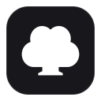
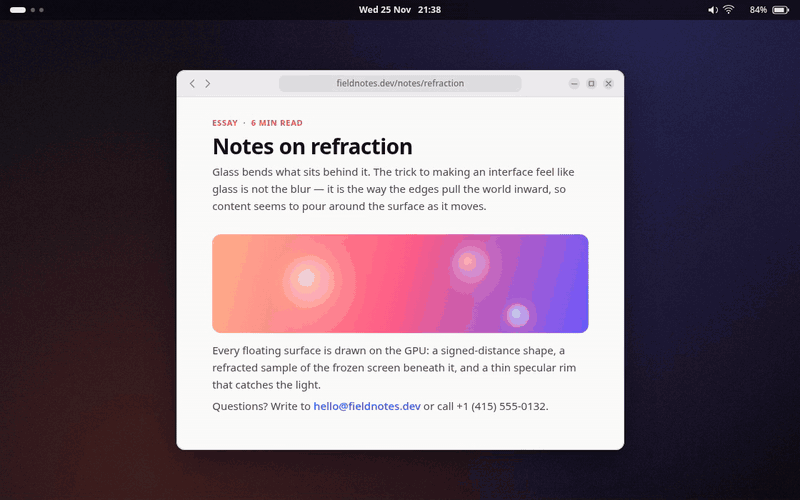
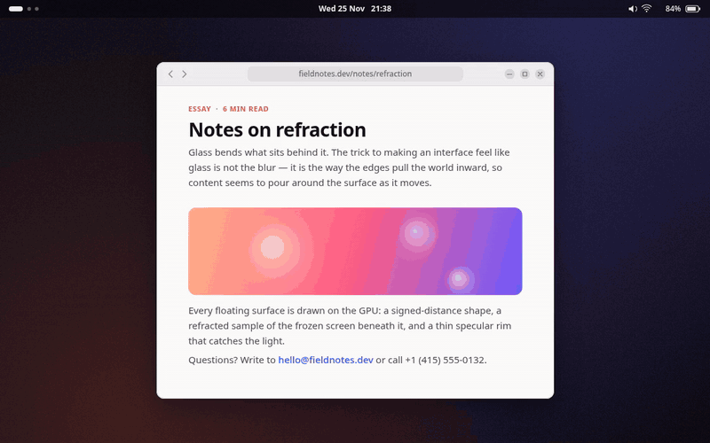
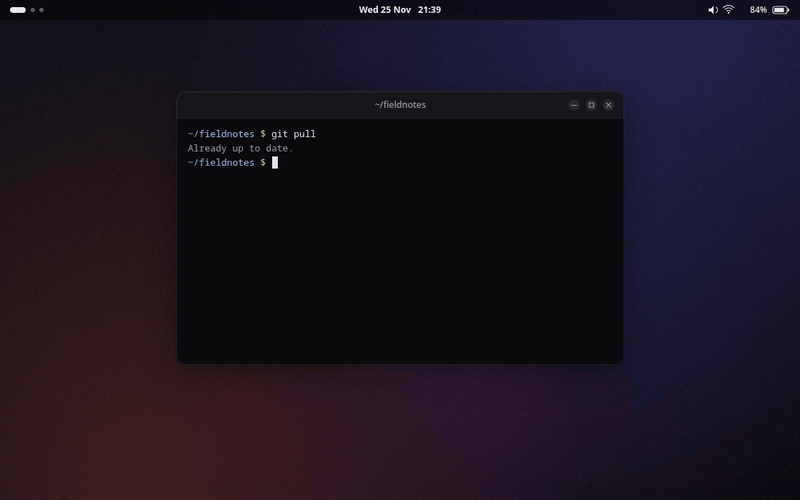

<div align="center">



# Kustik Screenshot

**Screenshots and screen recordings for Linux, one shortcut away.**
Select, annotate, copy. Or record, trim, and share as video or GIF.



[**Download**](https://github.com/KUSTIKs/kustik-screenshot/releases/latest/download/kustik-screenshot.flatpak) ·
[**Website**](https://screenshot.kustik.xyz/) ·
[Install](#install) · [Use](#use) · [Desktops](#desktops)

</div>

## Install

1. Download [`kustik-screenshot.flatpak`](https://github.com/KUSTIKs/kustik-screenshot/releases/latest/download/kustik-screenshot.flatpak).
2. Open it with your software center, or run:
   ```sh
   flatpak install --user kustik-screenshot.flatpak
   ```
3. Open **Kustik Screenshot** from your app menu. A small pill appears: it sets
   up <kbd>Super</kbd> <kbd>Shift</kbd> <kbd>S</kbd> and, if you like, starts
   the app on login.

That's it. Press the shortcut anywhere.

> Needs [Flatpak](https://flatpak.org/setup/) with Flathub (most distributions
> have it; the GNOME runtime is downloaded on first install).

## Use

| | |
| --- | --- |
| <kbd>Super</kbd> <kbd>Shift</kbd> <kbd>S</kbd> | Freeze the screen and start a capture |
| Drag | Select an area, or click a window |
| <kbd>Space</kbd> | Whole screen |
| <kbd>Tab</kbd> | Switch between screenshot and recording |
| <kbd>Enter</kbd> | Copy and close |
| <kbd>Esc</kbd> | Cancel |

### Screenshot → annotate → copy



Arrows, boxes, pen, highlighter and text. The result goes to the clipboard,
ready to paste, and a small card lets you save, pin it on screen, or edit again.

### Record an area or the whole screen


Microphone and system sound, pause and resume. Stop with the shortcut or the
recording bar; the video is copied and saved to `~/Videos/Recordings`.

Recording the whole screen? Nothing of the app is in the video: the controls
move to the tray (a red dot with the time), and the shortcut stops it.

### Trim and share as video or GIF



Click the preview to open the editor, drag the ends, and copy as MP4 or GIF.

### Pin a capture

A pinned capture (<kbd>Ctrl</kbd> <kbd>P</kbd>) floats above every window: a
reference while you work. Drag it anywhere, scroll to resize, double-click to
close.

### Where things go

Screenshots you save go to `~/Pictures/Screenshots`. Everything stays on your
computer: no account, no network, no telemetry.

## Desktops

Works on Wayland and X11. How it captures depends on the desktop:

| Desktop | Capture | Notes |
| --- | --- | --- |
| niri, Sway, Hyprland, river, labwc, Wayfire | Direct, instant | The welcome pill copies the line to add to your config for the shortcut. Click-a-window: niri. |
| GNOME, KDE Plasma, COSMIC | Through the desktop's screen-capture portal | The first screenshot/recording asks for permission once. The shortcut is set through your desktop's own dialog. |
| X11 sessions | Through the portal, or X11 directly | |

> Tested by me on niri only (Arch, AMD). Other desktops are built against
> their standards but not tried on real machines yet. Issues and reports are
> very welcome.

## Build from source

```sh
./flatpak/build.sh bundle   # builds and installs the Flatpak, writes flatpak/kustik-screenshot.flatpak
```

Or run it directly from the source tree: see [docs/DEVELOPING.md](docs/DEVELOPING.md).

## License

MIT. Bundled [Geist](https://vercel.com/font) fonts: SIL Open Font License.
